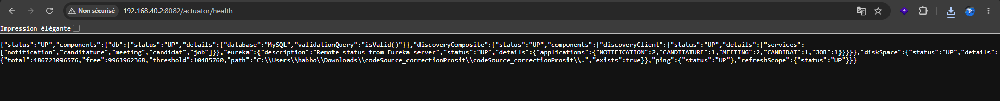
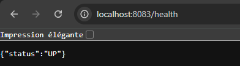
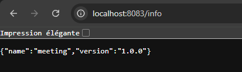
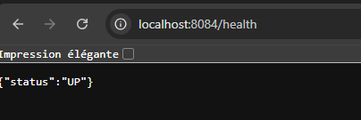
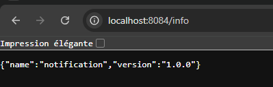
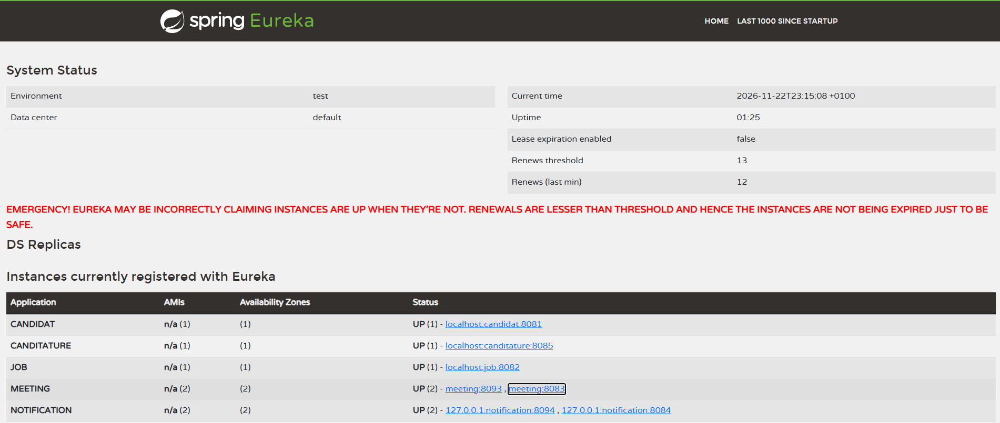

# Atelier Eureka - Architecture Web Distribuée

## Équipe
- Chatha Dalhoumi
- Dhia Trabelsi
- Yassine Gharbi
- Bechir Haboubi
  Nom de l'équipe : smartcampus

## Architecture

| Microservice | Technologie | Port | Nom dans Eureka |
|---|---|---|---|
| Eureka Server | Spring Boot | 8761 | - |
| Candidat | Spring Boot + H2 | 8081 | CANDIDAT |
| Job | Spring Boot + MySQL | 8082 | JOB |
| Candidature | Spring Boot | 8085 | CANDITATURE |
| Meeting | Node.js / Express | 8083 | MEETING |
| Notification | Python / FastAPI | 8084 | NOTIFICATION |

## Lancement

Ordre de démarrage :

1. MySQL (XAMPP ou WAMP)
2. Serveur Eureka (`backend/backend/eureka`)
3. Candidat, Candidature, Job (`backend/backend/microservices/...`)
4. Meeting : `npm install` puis `npm start`
5. Notification : `pip install -r requirements.txt` puis `python -m app.main`

Une deuxième instance se lance avec une autre valeur de `PORT`, par exemple
`$env:PORT=8093; npm start` (Meeting) ou `$env:PORT=8094; python -m app.main` (Notification).

## Atelier 1 : Eureka Server

Dashboard Eureka avec les services CANDIDAT, CANDITATURE, JOB, MEETING et NOTIFICATION
visibles en même temps, avec 2 instances de CANDIDAT, de MEETING et de NOTIFICATION.

## Atelier 2 : Observabilité avec Spring Boot Actuator

Actuator est ajouté à Candidat, Job et Candidature. Endpoints exposés : `health`, `info`, `metrics`.
Le statut de `/health` est transmis à Eureka (`eureka.client.healthcheck.enabled=true`).

### /actuator/health (Job, UP)

### Panne de la base MySQL

MySQL arrêté : `/actuator/health` de Job renvoie DOWN (composant `db`), et le dashboard Eureka
affiche JOB en DOWN. Candidat et Candidature restent UP. Après redémarrage de MySQL, Job repasse UP.

### /actuator/info (Candidat)

### /actuator/metrics

**Combien de requêtes HTTP Candidat a-t-il traitées (COUNT) ?**
27 requêtes (`/actuator/metrics/http.server.requests`).

**Durée de la requête la plus lente (MAX) ?**
0,5724552 seconde (environ 572 ms).

**Que donne `/actuator/metrics/http.server.requests?tag=status:200` ?**
Seules les requêtes réussies (code 200) sont comptées : COUNT = 25.
Les 2 autres requêtes sont un 404 et une redirection 302.

**Mémoire JVM utilisée (`jvm.memory.used`)** : environ 167 Mo.

## Partie 5 : santé des services Node.js et Python

### Meeting (Node.js / Express)

Routes `GET /health` (`{"status":"UP"}`) et `GET /info` (nom et version lus dans `package.json`).
`healthCheckUrl` et `statusPageUrl` sont déclarées dans la configuration de `eureka-js-client`.

### Notification (Python / FastAPI)

Routes `GET /health` et `GET /info`.
`health_check_url` et `status_page_url` sont déclarées dans `eureka_client.init_async(...)`.

### Vérification dans le registre Eureka

`GET http://localhost:8761/eureka/apps/NOTIFICATION` affiche les deux URL.

### Dashboard final

Les liens des instances MEETING et NOTIFICATION ouvrent `/info`.

## Dashboard Eureka

### /actuator/metrics

**Combien de requêtes HTTP Candidat a-t-il traitées (COUNT) ?**
27 requêtes (`/actuator/metrics/http.server.requests`).

**Durée de la requête la plus lente (MAX) ?**
0,5724552 seconde (environ 572 ms).

**Que donne `/actuator/metrics/http.server.requests?tag=status:200` ?**
Seules les requêtes avec le code HTTP 200 (succès) sont comptées : COUNT = 25.
Les 2 autres requêtes sont des 404 et 302 (`/**` et redirection Swagger).

**Mémoire JVM utilisée (`jvm.memory.used`)** : environ 167 Mo (167 155 696 octets).