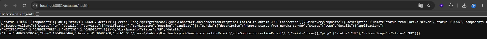
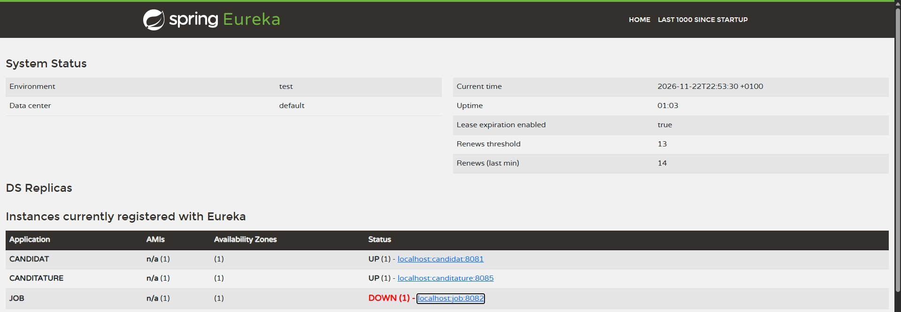
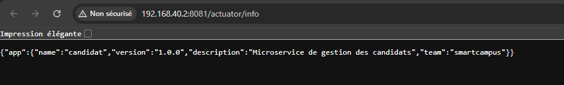
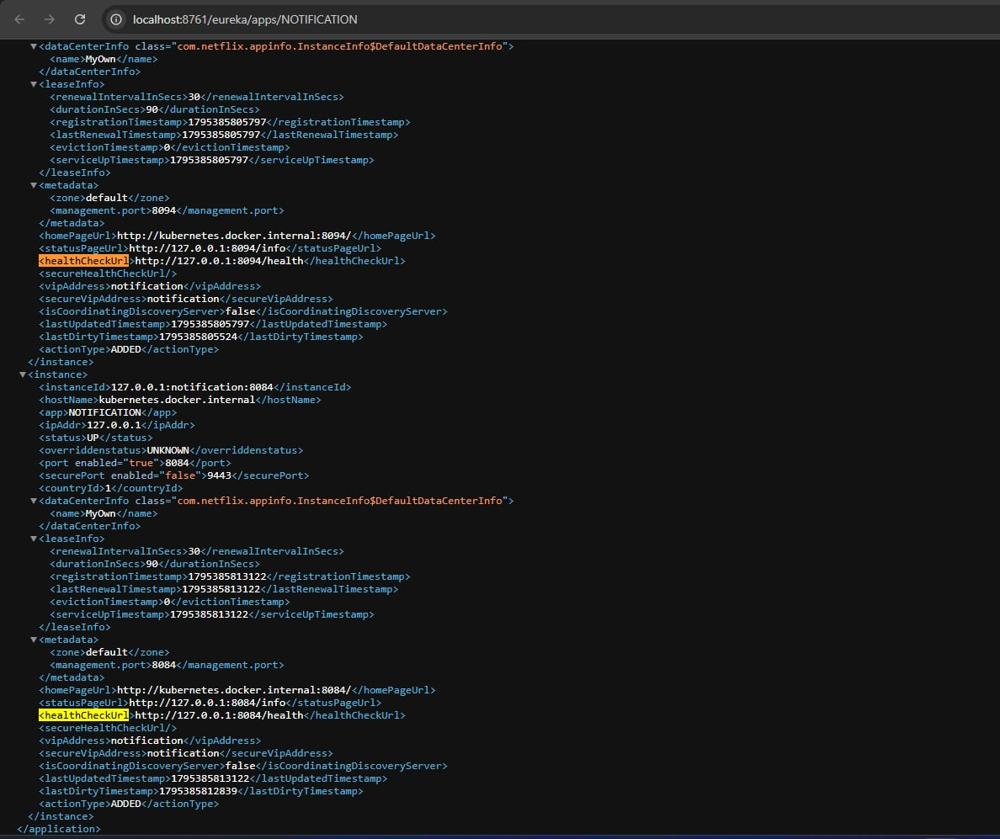
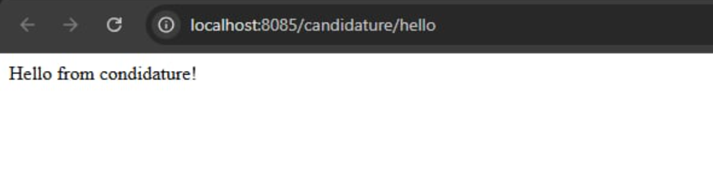

# Atelier Eureka - Architecture Web Distribuée

## Équipe

- Chatha Dalhoumi
- Dhia Trabelsi
- Yassine Gharbi
- Bechir Haboubi

**Nom de l'équipe : smartcampus**

---

## Architecture

| Microservice | Technologie | Port | Nom dans Eureka |
|---|---|---:|---|
| Eureka Server | Spring Boot | 8761 | - |
| API Gateway | Spring Cloud Gateway | 8090 | APIGATEWAY |
| Candidat | Spring Boot + H2 | 8081 | CANDIDAT |
| Job | Spring Boot + MySQL | 8082 | JOB |
| Candidature | Spring Boot | 8085 | CANDITATURE |
| Meeting | Node.js / Express | 8083 | MEETING |
| Notification | Python / FastAPI | 8084 | NOTIFICATION |

---

## Lancement

Ordre de démarrage :

1. Démarrer MySQL avec XAMPP ou WAMP.
2. Démarrer le serveur Eureka dans `backend/backend/eureka`.
3. Démarrer Candidat, Candidature et Job dans `backend/backend/microservices`.
4. Démarrer Meeting avec `npm install`, puis `npm start`.
5. Démarrer Notification avec `pip install -r requirements.txt`, puis `python -m app.main`.
6. Démarrer l'API Gateway dans `backend/backend/apiGateway`.

Une deuxième instance peut être lancée avec une autre valeur de port.

Exemple pour Meeting :

```powershell
$env:PORT=8093
npm start
```

Exemple pour Notification :

```powershell
$env:PORT=8094
python -m app.main
```

---

# Atelier 1 : Eureka Server

Le dashboard Eureka affiche les services suivants :

- `CANDIDAT`
- `CANDITATURE`
- `JOB`
- `MEETING`
- `NOTIFICATION`

Deux instances de Candidat, Meeting et Notification ont été lancées avec des ports différents.


---

# Atelier 2 : Observabilité avec Spring Boot Actuator

Spring Boot Actuator a été ajouté aux microservices Candidat, Job et Candidature.

Les endpoints exposés sont :

- `health`
- `info`
- `metrics`

Le statut de `/actuator/health` est transmis à Eureka avec la propriété suivante :

```properties
eureka.client.healthcheck.enabled=true
```

---

## Test de `/actuator/health` pour Job

Lorsque MySQL fonctionne, l'endpoint de Job retourne le statut `UP`.


---

## Test de la panne de MySQL

Lorsque MySQL est arrêté, `/actuator/health` de Job retourne le statut `DOWN` à cause du composant `db`.

Le dashboard Eureka affiche aussi le microservice Job en état `DOWN`.

Les microservices Candidat et Candidature restent en état `UP`.

Après le redémarrage de MySQL, Job repasse en état `UP`.





---

## Test de `/actuator/info` pour Candidat

L'endpoint `/actuator/info` affiche les informations du microservice Candidat.



---

## Test de `/actuator/metrics`

### Combien de requêtes HTTP Candidat a-t-il traitées ?

Le microservice Candidat a traité **27 requêtes** selon la métrique :

```text
/actuator/metrics/http.server.requests
```

### Quelle est la durée de la requête la plus lente ?

La valeur maximale obtenue est :

```text
0,5724552 seconde
```

Cela correspond à environ **572 millisecondes**.

### Résultat avec le filtre `status:200`

L'endpoint utilisé est :

```text
/actuator/metrics/http.server.requests?tag=status:200
```

Seules les requêtes réussies avec le code HTTP `200` sont comptées.

Le résultat obtenu est :

```text
COUNT = 25
```

Les deux autres requêtes correspondent à une erreur `404` et à une redirection `302`.

### Mémoire JVM utilisée

La valeur de `jvm.memory.used` est d'environ :

```text
167 Mo
```

La valeur exacte observée est de `167 155 696` octets.

---

## Santé des services Node.js et Python

### Meeting avec Node.js et Express

Les routes suivantes ont été ajoutées :

```text
GET /health
GET /info
```

La route `/health` retourne :

```json
{
  "status": "UP"
}
```

La route `/info` retourne le nom et la version lus depuis le fichier `package.json`.

Les propriétés `healthCheckUrl` et `statusPageUrl` sont déclarées dans la configuration de `eureka-js-client`.


---

### Notification avec Python et FastAPI

Les routes suivantes ont été ajoutées :

```text
GET /health
GET /info
```

Les propriétés `health_check_url` et `status_page_url` sont déclarées dans la méthode :

```python
eureka_client.init_async(...)
```


---

### Vérification dans le registre Eureka

L'adresse suivante affiche les instances enregistrées du microservice Notification :

```text
GET http://localhost:8761/eureka/apps/NOTIFICATION
```



---

### Dashboard final de l'Atelier 2

Les liens des instances Meeting et Notification permettent d'accéder à leurs endpoints `/info`.


---

# Atelier 3 : Mise en place d'une API Gateway

## Objectif

Le but de cet atelier est de mettre en place une API Gateway pour centraliser l'accès aux différents microservices du projet JobBoard.

Deux types de configuration ont été réalisés :

- une configuration statique avec les adresses et les ports des microservices ;
- une configuration dynamique avec Eureka et Spring Cloud LoadBalancer.

L'API Gateway fonctionne sur le port `8090`.

---

## Dépendances utilisées

Les principales dépendances utilisées dans le projet API Gateway sont :

- Spring Cloud Gateway Server Web MVC ;
- Eureka Discovery Client ;
- Spring Cloud LoadBalancer ;
- Spring Boot Actuator.

---

## 1. Configuration statique

Dans la première partie, les routes ont été déclarées directement avec l'adresse et le port de chaque microservice.

Exemple de configuration statique pour Candidature :

```properties
spring.cloud.gateway.server.webmvc.routes[0].id=candidature
spring.cloud.gateway.server.webmvc.routes[0].uri=http://localhost:8085
spring.cloud.gateway.server.webmvc.routes[0].predicates[0]=Path=/candidature/**
```

La route Candidature a été testée avec l'endpoint suivant :

```text
GET http://localhost:8085/candidature/hello
```

La réponse obtenue est :

```text
Hello from candidature!
```



---

## 2. Configuration dynamique avec Eureka

Dans la deuxième partie, les adresses fixes ont été remplacées par les noms des microservices enregistrés dans Eureka.

Le préfixe `lb://` permet à l'API Gateway de demander à Eureka une instance disponible du microservice.

### Route dynamique de Candidat

```properties
spring.cloud.gateway.server.webmvc.routes[0].id=candidat
spring.cloud.gateway.server.webmvc.routes[0].uri=lb://CANDIDAT
spring.cloud.].predicates[0]=Path=/api/jobs/**,/api/categories/**
```

### Route dynamique de Candidature

```properties
spring.cloud.gateway.server.webmvc.routes[2].id=candidature
spring.cloud.gateway.server.webmvc.routes[2].uri=lb://CANDITATURE
spring.cloud.gateway.server.webmvc.routes[2].predicates[0]=Path=/candidature/**
```

### Route dynamique de Meeting

```properties
spring.cloud.gateway.server.webmvc.routes[3].id=meeting
spring.cloud.gateway.server.webmvc.routes[3].uri=lb://MEETING
spring.cloud.gateway.server.webmvc.routes[3].predicates[0]=Path=/api/meetings/**
```

### Route dynamique de Notification

```properties
spring.cloud.gateway.server.webmvc.routes[4].id=notification
spring.cloud.gateway.server.webmvc.routes[4].uri=lb://NOTIFICATION
spring.cloud.gateway.server.webmvc.routes[4].predicates[0]=Path=/api/notifications/**
```

La Gateway utilise les noms des services enregistrés dans Eureka au lieu d'utiliser directement leurs ports.

---

## 3. Enregistrement dans Eureka

L'API Gateway est enregistrée dans Eureka sous le nom `APIGATEWAY` sur le port `8090`.

Le dashboard Eureka montre les services suivants en état `UP` :

- API Gateway sur le port `8090` ;
- Candidat sur les ports `8081` et `8091` ;
- Job sur le port `8082` ;
- Candidature sur le port `8085` ;
- Meeting sur les ports `8083` et `8093` ;
- Notification sur les ports `8084` et `8094`.

documentation/gateway-eureka-dashboard.png

---

## 4. Tests de la configuration dynamique

### Test du microservice Candidat

La route Candidat a été testée à travers l'API Gateway :

```text
GET http://localhost:8090/candidates
```

La réponse obtenue est :

```json
[]
```

documentation/gateway-dynamic-candidat.png

La réponse `[]` signifie que la requête fonctionne correctement, mais que la table ne contient pas encore de candidats.

---

### Test du microservice Job

La route Job a d'abord été testée directement :

```text
GET http://localhost:8082/api/jobs
```

Elle a ensuite été testée à travers l'API Gateway :

```text
GET http://localhost:8090/api/jobs
```

La réponse obtenue dans les deux cas est :

```json
[]
```

documentation/gateway-dynamic-job.png

La même réponse en accès direct et à travers la Gateway confirme que la requête est correctement transmise au microservice Job.

---

### Test des catégories du microservice Job

La route des catégories a été testée à travers l'API Gateway :

```text
GET http://localhost:8090/api/categories
```

La réponse obtenue est :

```json
[]
```

documentation/gateway-dynamic-categories.png

La réponse `[]` signifie que la route fonctionne, mais qu'aucune catégorie n'est encore enregistrée.

---

### Test du microservice Meeting

Le microservice Meeting a été testé à travers l'API Gateway :

```text
GET http://localhost:8090/api/meetings/hello
```

documentation/gateway-dynamic-meeting.png

---

### Test du microservice Notification

Le microservice Notification a été testé à travers l'API Gateway :

```text
GET http://localhost:8090/api/notifications/hello
```

documentation/gateway-dynamic-notification.png

Ces tests montrent que l'API Gateway centralise l'accès aux microservices Candidat, Job, Meeting et Notification.

---

## 5. Load balancing

Deux instances du microservice Candidat sont enregistrées dans Eureka :

- une instance sur le port `8081` ;
- une instance sur le port `8091`.

Les deux instances utilisent le même nom `CANDIDAT`.

Spring Cloud LoadBalancer permet à la Gateway de sélectionner une instance disponible lors d'un appel vers :

```properties
uri=lb://CANDIDAT
```

Les logs de la Gateway et du LoadBalancer ont été activés avec :

```properties
logging.level.org.springframework.cloud.gateway=DEBUG
logging.level.org.springframework.cloud.loadbalancer=DEBUG
```

L'algorithme utilisé par défaut est Round Robin. Les requêtes sont distribuées à tour de rôle entre les instances disponibles.

---

## Conclusion

Dans cet atelier, nous avons mis en place une API Gateway avec deux types de configuration.

La configuration statique utilise directement les adresses et les ports des microservices.

La configuration dynamique utilise Eureka et les noms des services avec le préfixe `lb://`. Cette configuration est plus flexible, car la Gateway peut trouver automatiquement les instances disponibles.

Les routes des microservices Candidat, Job, Meeting et Notification ont été testées à travers l'API Gateway.

---

## Lien Git du projet JobBoard

Dépôt GitHub :

https://github.com/BechirHaboubi/awd-eureka-actuator